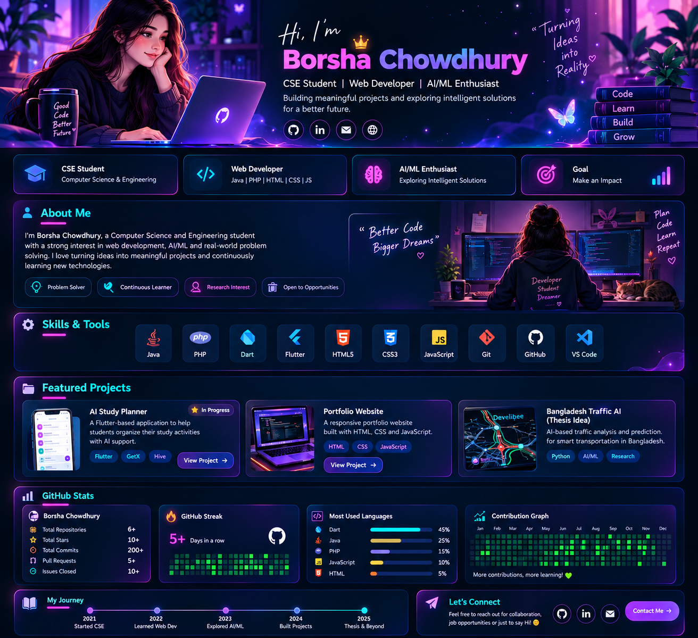

<!-- The approved design is preserved exactly as the full-width visual -->

 

  

> **Design note:** The image above is the exact approved visual mockup. Its illustrated GitHub statistics, timeline dates, and project cards are **design examples**, not verified live account data. The sections below are the editable, actual README content.

## 🌌 About Me

I'm **Borsha Chowdhury**, a Computer Science & Engineering student interested in web development, AI/ML, and building useful software.

- 💻 Exploring **Java, PHP, HTML, CSS, and JavaScript**
- 📱 Working on an **AI Study Planner** using Flutter
- 🤖 Interested in AI/ML applications and real-world problems
- 🔬 Exploring research and thesis directions
- 🌱 Learning by building and documenting projects

## ⚡ Skills & Tools

## 🚀 Featured Projects

| Project | Description | Stack | Status |
|---|---|---|---|
| 📚 **AI Study Planner** | Study planning and organization app | Flutter, Dart, GetX, Hive | In progress |
| 💻 **Developer Portfolio** | Personal developer profile and visual portfolio | HTML, CSS, JavaScript | Portfolio concept |
| 🚦 **Bangladesh Traffic AI** | Potential AI/ML research direction for traffic challenges | Research idea | Idea only |

**[Browse my GitHub repositories →](https://github.com/borshachowdhury?tab=repositories)**

## 📊 GitHub Activity

<!-- These cards are live third-party images; they may be unavailable during outages. -->

## 🎯 My Journey

- **Now:** Strengthen CSE fundamentals and finish practical projects
- **Next:** Publish clean repositories with screenshots and documentation
- **Career:** Prepare for internships and software developer opportunities
- **Research:** Explore AI/ML thesis problems with real-world relevance

## 🤝 Connect With Me

- 💻 **GitHub:** [@borshachowdhury](https://github.com/borshachowdhury)
- 📬 **Email / LinkedIn:** Add your verified public contact links here

### ✨ Code • Learn • Build • Grow ✨

